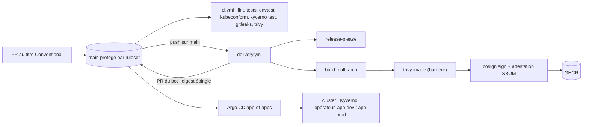

# k8s-platform-lab

[](https://github.com/epierret/k8s-platform-lab/actions/workflows/ci.yml)
[](https://scorecard.dev/viewer/?uri=github.com/epierret/k8s-platform-lab)
[](https://github.com/epierret/k8s-platform-lab/releases)
[](go.mod)
[](LICENSE)

> Une petite API Go et un opérateur Kubernetes sur mesure, **construits et signés en CI sans aucun secret longue durée**, livrés par **GitOps (Argo CD)**, et **admis dans le cluster uniquement si leur signature et leur SBOM sont valides** (Kyverno).

Ce dépôt est volontairement court. Chaque brique est une pratique qu'une équipe plateforme utilisé en production.

---

## Architecture



**Le trajet d'un changement :**

1. Une pull request avec un titre Conventional Commits (`feat:`, `fix:`…) est ouverte vers une branche `main` protégée.
2. La CI lance en parallèle le lint, les tests unitaires et envtest, la validation des manifests, les tests de politiques, la détection de secrets et le scan de vulnérabilités.
3. Au merge, `delivery.yml` construit des images `linux/amd64` + `linux/arm64`, les scanne, puis les signe sans clé et leur attache une attestation SBOM CycloneDX.
4. Un bot ouvre une PR de promotion qui épingle la nouvelle image **par digest** dans l'overlay dev. La prod n'est promue qu'à la publication d'une release.
5. Argo CD tire Git et fait converger le cluster. Kyverno refuse toute image qui n'a pas été signée par le workflow de CI de ce dépôt.

---

## Ce que ce dépôt démontre

| Domaine | Pratiques | Où regarder |
| --- | --- | --- |
| **Gouvernance Git** | Trunk-based development, squash merge, commits signés, rulesets as code, CODEOWNERS, versioning sémantique automatisé | [`.github/rulesets/main.json`](.github/rulesets/main.json), [`.github/CODEOWNERS`](.github/CODEOWNERS), `release-please-config.json` |
| **App cloud-native** | Séparation liveness/readiness, arrêt gracieux, version injectée au build, image distroless non-root | [`internal/app`](internal/app), [`cmd/app`](cmd/app), [`Dockerfile`](Dockerfile) |
| **CI/CD** | Permissions minimales, actions épinglées par SHA, reusable workflows + composite actions, OIDC, builds multi-arch | [`.github/workflows`](.github/workflows), [`.github/actions`](.github/actions) |
| **Kubernetes** | Kustomize base/overlays, HPA, PDB, NetworkPolicy deny-all par défaut, Pod Security Admission `restricted` | [`deploy/app`](deploy/app), [`deploy/namespaces`](deploy/namespaces) |
| **Opérateur** | Go, markers Kubebuilder, controller-runtime, CRD avec validation OpenAPI, finalizers, conditions de statut, envtest | [`api/v1alpha1`](api/v1alpha1), [`internal/controller`](internal/controller) |
| **GitOps** | Argo CD app-of-apps, sync waves avec un health check fonctionnel, promotion par PR, rollback par `git revert` | [`gitops`](gitops), [`bootstrap/argocd`](bootstrap/argocd) |
| **Sécurité de la supply chain** | Trivy, gitleaks, Sigstore cosign (keyless), SBOM CycloneDX, politiques Kyverno en CEL testées en CI, OpenSSF Scorecard | [`deploy/policies`](deploy/policies), [`SECURITY.md`](SECURITY.md) |

---

## L'opérateur `WebApp`

Un développeur décrit son application en dix lignes :

```yaml
apiVersion: platform.enrique-pierret.com/v1alpha1
kind: WebApp
metadata:
  name: levi
  namespace: webapp-demo
spec:
  image: ghcr.io/epierret/k8s-platform-lab/app@sha256:...
  replicas: 2
```

L'opérateur en fait un `Deployment` et un `Service` durcis (non-root, seccomp `RuntimeDefault`, toutes les capabilities retirées, système de fichiers en lecture seule, sondes, ressources par défaut) et publie un statut honnête :

```console
$ kubectl get webapps -n webapp-demo
NAME     DESIRED   READY   AVAILABLE
levi     2         2       True
```

| Essaie | Ce qui se passe | Notion |
| --- | --- | --- |
| `kubectl -n webapp-demo delete deploy levi` | Recréé en une seconde | Réconciliation pilotée par l'état, self-healing |
| `kubectl -n webapp-demo scale deploy levi --replicas=5` | Revient à 2 | La ressource custom est la source de vérité |
| `kubectl -n webapp-demo patch wa levi --type merge -p '{"spec":{"replicas":11}}'` | Refusé par l'API server | Validation OpenAPI générée depuis les markers |
| `kubectl -n webapp-demo delete wa levi` | Entrée retirée de `webapp-system/webapp-registry` | Finalizer pour un état que le garbage collector ne peut pas atteindre |

Choix de conception :

- Les objets enfants sont nettoyés par les **ownerReferences**. Le finalizer ne sert qu'à l'entrée du registre, qui vit dans un autre namespace.
- `GenerationChangedPredicate` empêche le contrôleur de se réveiller à cause de ses propres écritures de statut.
- Le selector du Deployment n'est défini qu'à la création, car il est immuable.
- Les tests appellent `Reconcile` directement contre un vrai API server (envtest) : déterministes, sans `sleep`.

---

## Vérifie la supply chain toi-même

Chaque image est signée par le workflow de build réutilisable de ce dépôt, sur `main` ou sur un tag de release, et rien d'autre n'est accepté.

```bash
IMAGE=ghcr.io/epierret/k8s-platform-lab/app:main
ID='^https://github\.com/epierret/k8s-platform-lab/\.github/workflows/_build-image\.yml@'

# Signature
cosign verify "$IMAGE" \
  --certificate-oidc-issuer https://token.actions.githubusercontent.com \
  --certificate-identity-regexp "$ID"

# Attestation SBOM (nombre de composants)
cosign verify-attestation --type cyclonedx "$IMAGE" \
  --certificate-oidc-issuer https://token.actions.githubusercontent.com \
  --certificate-identity-regexp "$ID" | jq -r .payload | base64 -d | jq '.predicate.components | length'
```

À l'admission, Kyverno applique la même vérification d'identité : une image signée depuis un laptop ou un fork est refusée, même si elle se trouve dans le bon registre.

---

## Démarrage rapide

**Prérequis :** Docker, `kubectl`, `make`, Go 1.26+. Un cluster local [kind](https://kind.sigs.k8s.io/) est créé pour toi. Les versions des outils sont épinglées dans le [`Makefile`](Makefile) et tenues à jour par Renovate.

```bash
git clone https://github.com/epierret/k8s-platform-lab.git
cd k8s-platform-lab

make help        # liste toutes les commandes
make test        # tests unitaires + envtest
make validate    # rend et valide tous les manifests
make up          # kind + metrics-server + Kyverno + Argo CD + app-of-apps
make down        # supprime le cluster
```

Lancer l'opérateur contre ton cluster actuel, sans le déployer :

```bash
kubectl apply -f deploy/operator/crd/
kubectl apply -k deploy/namespaces
POD_NAMESPACE=webapp-system go run ./cmd/operator
kubectl apply -k deploy/samples     # dans un autre terminal
```


---

## Organisation du dépôt

```text
api/v1alpha1/          types de la CRD WebApp et markers kubebuilder
cmd/{app,operator}/    points d'entrée
internal/app/          service HTTP (healthz, readyz, version, arrêt gracieux)
internal/controller/   réconciliateur, builders purs, suite envtest
deploy/                tout ce qu'Argo CD synchronise (namespaces, app, opérateur, politiques, samples)
gitops/                app-of-apps
bootstrap/             la seule partie impérative : cluster, Argo CD, metrics-server
.github/               workflows, composite action, ruleset, CODEOWNERS, template de PR
```

---

## Choix techniques

| Choix | Pourquoi |
| --- | --- |
| Trunk-based, squash merge, titre de PR vérifié | Un seul commit Conventional propre par changement : versions et changelogs sont générés, jamais écrits à la main |
| Kustomize plutôt que Helm pour l'app | Du YAML pur, natif à `kubectl` et Argo CD. Helm est utile pour distribuer un logiciel à d'autres |
| Pas de `replicas` dans le Deployment | Le HPA en est propriétaire, sinon Argo CD et le HPA se battent à chaque synchronisation |
| Pas de limite CPU, mais une limite mémoire | Le throttling CFS dégrade la latence ; les requests servent au placement, la limite mémoire protège le nœud |
| Promotion par PR du bot plutôt qu'Argo CD Image Updater | Chaque déploiement est un commit relu et révocable, et rien dans le cluster n'écrit dans Git |
| Signature keyless avec Sigstore | Aucune clé privée à stocker, faire tourner ou risquer de faire fuiter ; chaque signature est inscrite dans le journal public Rekor |
| Politiques Kyverno en CEL (`policies.kyverno.io/v1`) | Le même langage que la `ValidatingAdmissionPolicy` native de Kubernetes, testé avec `kyverno test` en CI |
| Un seul secret dans tout le dépôt | La clé de la GitHub App du bot de promotion, car les PR ouvertes avec `GITHUB_TOKEN` ne déclenchent pas la CI |

---

## Feuille de route

Volontairement hors périmètre pour cette itération :

- Observabilité : traces OpenTelemetry et métriques Prometheus pour l'app et l'opérateur
- Un champ `spec.ingressHost` sur `WebApp`, qui crée une `HTTPRoute` (Gateway API) possédée par la WebApp
- Provenance SLSA du build avec `actions/attest-build-provenance`
- Une branche Flux pour comparer avec Argo CD
- Un chart Helm pour l'opérateur, et Terraform pour un cluster cloud

---

## Sécurité

Voir [`SECURITY.md`](SECURITY.md) pour signaler une vulnérabilité en privé et pour le détail des garanties de la supply chain.

## Auteur

**Enrique Pierret**, ingénieur Cloud & DevOps (CKA, LFCS).
[LinkedIn](https://www.linkedin.com/in/enrique-pierret-1b97502b) · [Site](https://enrique-pierret.com) · [Medium](https://medium.com/@pierretenrique)
